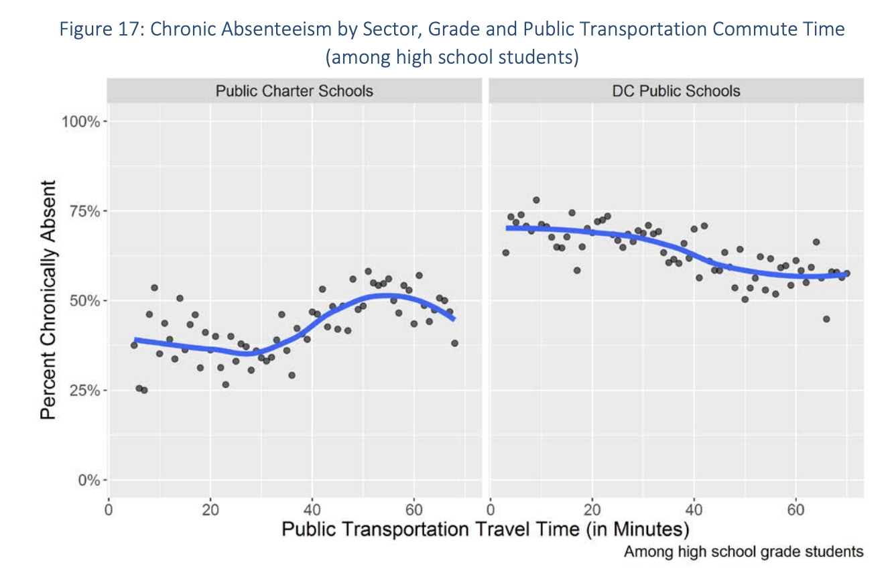
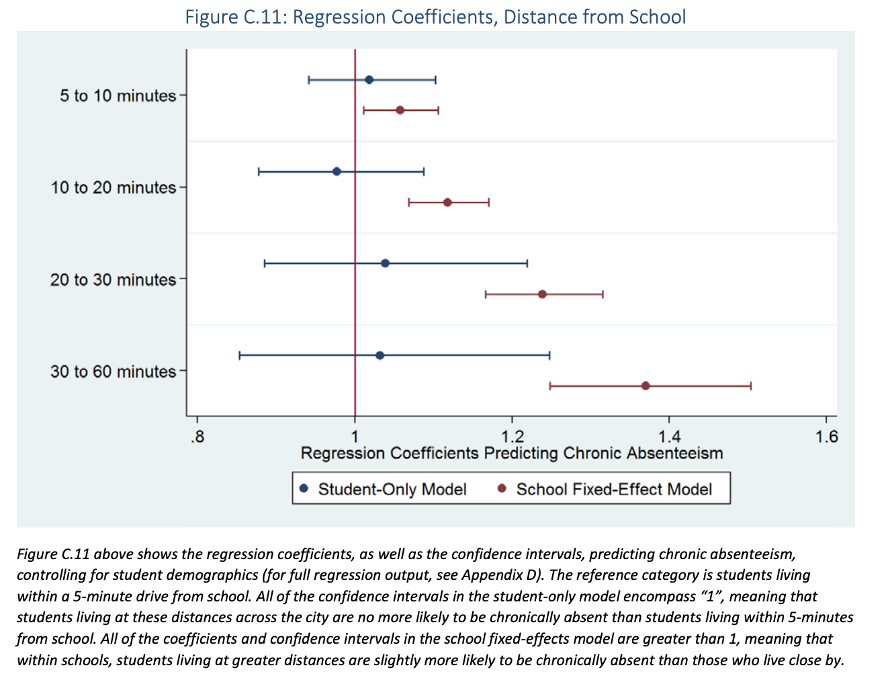

The short story:
--------------

If you need a cost-effective alternative to Google's API for processing/cleaning/standardizing geographic data and determining commute time and distance -- not just distance as the crow flies, but time/distance driving, biking, or using public transportation -- consider [georoute](https://journals.sagepub.com/doi/abs/10.1177/1536867X221083857?journalCode=stja)! I assisted with the development of some of the parameters after using the initial version of the program for a research project.

The longer, more personal story:
--------------

Processing geographic data is a consistent task in the world of data analysis. There are many, many tools out there on the market for handling and converting raw geographic data into a standardized format for analysis; Google's geocoding API is one of the gold standards at the heart of many community developed programs. [Prior to July 2018](https://www.findingyourway.io/blog/2018/12/05/2018-12-05-using-ggmap-after-july-2018/), Google's geocoding services were free up until a certain volume and various functions, such as the powerful and useful [ggmap], allowed users a variety geocoding functions at little to no cost. However, this all changed when Google restructured their API pricing in 2018 (which, I get, I guess -- money to be had).

Around this time, I was working as a researcher for the Office of the State [Superintendent](https://www.youtube.com/watch?v=av4lbel9aIo) of Education in the Office of Research, Analysis, and Reporting -- try saying that three times fast; at a certain point, I just told people I worked for the city. One of the first research projects I was tasked with was the annual attendance report to Council. This report was one of the agency's many obligations to the city, informing policymakers about various metrics relating to education. Prior to my time, someone much smarter than me decided to use this report as a sneaky opportunity to not just release high-level, aggregated truancy numbers, but to try and answer deeper questions about the root cause of attendance issues. When I joined the project for the 2017-18 school year, one of the key research questions was: what is the relationship between a students commute time and their attendance. I eagerly jumped on this question because, at the time, I was knee deep in other geocoding projects (like [bike accidents](https://gwarrenn.github.io/Bike-Accidents-in-The-District/) and [stop and frisk](https://gwarrenn.github.io/Stop-and-Frisk-DC/)! However, to my dismay, Google had just changed their API pricing and the amount of geocoding/routing I would need to do would cost the taxpayers of DC a few thousand dollars. 

This realization was crushing ... until my boss at the time, Eva Corcoran, pulled up Google to find an existing geocoding service written in Stata(!), which was our main codebase, and, even better, it used a competitor's georouting services free of charge (with the exception of some rate-limiting)! The function was called [georoute](https://www.stata-journal.com/article.html?article=dm0092) and used [HERE's georouting/geocoding API](link). The program accomplished everything I needed, offering the estimated commute times from point A to point B. However, one of the key things that I needed was to simulate the commute times during specific times of day, factoring in traffic, and, in some cases, show various modes of transportation. Fortunately, HERE's API supported all of these parameters, but the existing Stata function didn't. So, to solve this, I simply went into the source code (yay, open source!) and made the edits myself. With this accomplished, I was able to run the specific analysis and publish it in the yearly report to Council, [link here](https://osse.dc.gov/sites/default/files/dc/sites/osse/publication/attachments/2017-18%20School%20Year%20Attendance%20Report.pdf). I even had the opportunity to present the findings to the education subcommittee later that year -- side note, [Phil Mendelson](https://i0.wp.com/newspack-washingtoncitypaper.s3.amazonaws.com/uploads/2020/12/blogs_looselips_files_2014_02_ll_mendo_1.png?fit=1200%2C799&ssl=1) terrified me and I went into a fugue state in order to present my section. 

Some time after wrapping up all the loose ends of the report, I decided I'd send an email to the original developers, letting them know that I made some edits to the function that may be helpful to the community. I was a little nervous that they'd brush me off as some random internet weirdo who hijacked their code, but to my delight the authors, Sylvain Weber and Martin Péclat, were very interested in my edits and brought me into the team to make the updates plus a few other code refactoring updates. They were even kind enough to include my name on the ensuing Stata Journal publication that was published to document the changes and new capabilities. I'll be forever grateful for their kindness in including me in this project and someday hope to meet them in person if I'm ever in Geneva.
