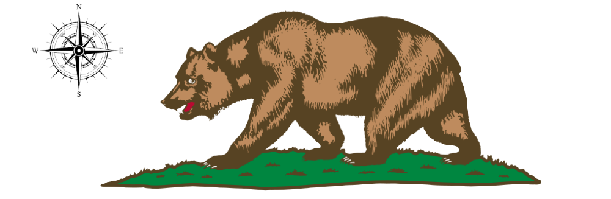

I'm not from California. I'm from Michigan, but over the years I've met plenty of people from California, who are pretty easy to identify because they'll tell you almost immediately that they're from California. Beyond that they are very quick to tell you that they are either from "Northern" or "Southern" California. As a non-Californian, this distinction means little to nothing to me, but to some it means <b>a lot.</b> But I don't have a great sense of what "Northern California" is vs. "Southern California." Obviously, to me, Los Angeles is clearly in Southern California and San Francisco is solidly Northern California, but what about someone from Fresno, or Bakersfield? And what about people from Redding? Do they think they're the true north?

Drawing heavily from one of my favorite YouTube channels Map Men, who tackled the question of [Where is the north/south divide](https://www.youtube.com/watch?v=ENeCYwms-Cc) of England, I decided to try and apply this to California, but with a more formal/quantifiable method of measuring opinion. This application is built to allow users to draw a line through California, along with some precious demographic information, that defines how they view the north/south boundary in California.

So, please join me in helping to contribute to another Thanksgiving Day argument at the table: [Fill out the survey here](https://what-is-california-726e.onrender.com/)

Technical Bits
--------------

The application is built/hosted on Heroku using the Flask framework. All of the mapping is done using a combination of mapbox-gl-js for the map layers, plus mapbox-gl-draw for the boundary drawing, as well as a bit of turfjs for some boundary data validation. On the backend, the data is being stored in a postgres database stored on Render (such a cool service!). That's pretty much it! I'm not a web developer at all, so the hardest part about it was optimizing the design to work for mobile users. The application is intended for desktop use, which allows the most screen real estate, but I realize that people (myself included) mostly interact withg the internet through their mobile device, so I had to do a bit of work to at least make it not look like complete garbage.